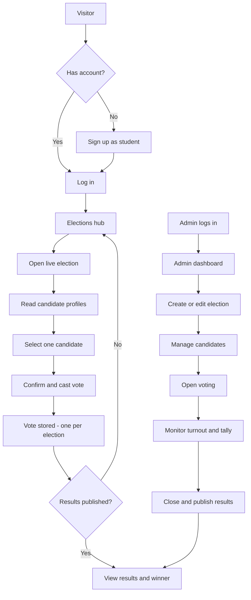

# PRD — BallotBox: SHS Student Council & Prefect Elections

## 1. Product Overview

BallotBox is a web platform where Senior High School (SHS) students vote securely in student council and prefect elections, and teachers (Electoral Officers) administer those elections end to end.

It replaces paper ballots and WhatsApp polls with one trustworthy flow: verified student accounts, one vote per student per election, and transparent published results.

## 2. Core Features

### 2.1 User Roles

| Role | Registration Method | Core Permissions |
|------|---------------------|------------------|
| Student (Voter) | Email + password sign-up with full name, student ID and class | Browse published elections, read candidate profiles and manifestos, cast exactly one vote per election, view results once published, view personal voting history |
| Admin (Electoral Officer / Teacher) | Pre-provisioned account, or promoted by an existing admin | Everything a student can do, plus: create and edit elections, add / edit / reorder candidates, open and close voting windows, publish results, monitor turnout and per-candidate tallies |

### 2.2 Feature Module

1. **Landing page**: hero + value proposition, "how voting works" steps, featured live election, entry CTAs.
2. **Auth pages (log in / sign up)**: student registration and login.
3. **Elections hub**: every election the student can see, with status chips (Live / Closed / Results out) and search.
4. **Election detail & ballot**: candidate cards (photo, class, slogan, manifesto), single-choice ballot, review + confirm step.
5. **Results page**: published tally with percentage bars, ranking and winner callout.
6. **Admin dashboard**: platform stats and a table of all elections with quick status controls.
7. **Admin election editor**: create/edit election metadata, manage candidates (add, edit, reorder, remove).
8. **Admin results monitor**: turnout, per-candidate counts, live updates.
9. **Profile**: student details and voting history.

### 2.3 Page Details

| Page Name | Module Name | Feature description |
|-----------|-------------|---------------------|
| Landing page | Hero | Bold headline, animated ballot motif, primary "Vote now" / "Sign in" CTAs |
| Landing page | How it works | 3-step explainer (Verify → Vote → See results) |
| Landing page | Live election teaser | Shows the currently active election and links to it |
| Log in | Auth form | Email + password, inline validation, error states, link to sign up |
| Sign up | Auth form | Full name, student ID, class, email, password, confirm password; creates profile automatically |
| Elections hub | Election list | Cards with position, status chip, candidate count, deadline countdown; search filter |
| Elections hub | Status filter | Tabs: All / Live / Closed / Results out |
| Election detail | Candidate grid | Candidate cards with photo, name, class, slogan, expandable manifesto |
| Election detail | Ballot | Radio-style selection, sticky "Cast vote" bar, confirmation dialog, voted-state lock |
| Election detail | Closed state | Read-only candidate list with "Voting closed" notice |
| Results page | Summary | Total votes, turnout %, winner badge |
| Results page | Tally | Per-candidate bars, counts and percentages, ranked ordering |
| Profile | Details | Editable full name / class, role badge |
| Profile | Voting history | List of elections voted in with timestamps |
| Admin dashboard | Stats | Total elections, live now, total votes cast, registered voters |
| Admin dashboard | Election table | Status, dates, votes, controls to open/close/publish, edit, delete |
| Admin election editor | Metadata form | Title, position, description, dates, results-visible toggle |
| Admin election editor | Candidate manager | Add/edit/remove candidates, photo URL, slogan, manifesto, drag order |
| Admin results monitor | Turnout panel | Voted vs eligible counts, progress bar |
| Admin results monitor | Live tally | Auto-refreshing candidate counts and ranking |

## 3. Core Process

**Student voting flow**: a student signs up → lands on the Elections hub → opens a Live election → reads candidate profiles → selects one candidate → confirms → the vote is written once (a database uniqueness rule blocks a second vote) → the election shows a "You voted" state → results appear when the admin publishes them.

**Admin flow**: an Electoral Officer logs in → opens the Admin dashboard → creates an election with metadata → adds candidates → opens voting → watches turnout and the live tally in the results monitor → publishes results when voting closes.

## 4. User Interface Design

### 4.1 Design Style

**Direction: "Risograph Ballot"** — a tactile, print-inspired civic aesthetic that feels like a screen-printed election poster and a real ballot paper. It is warm and youthful rather than corporate-government.

- **Palette**: warm paper base `#F5EFE3`, deep ink `#17150F`, accent poppy red `#E5482A`, accent cobalt `#1F44C9`, support mustard `#E3A82B`. One neutral base + two accents, used with intent.
- **Typography**: `Fraunces` (variable high-contrast serif) for display headlines and numbers, `Instrument Sans` for body copy, `DM Mono` for tabular data, IDs and deadlines.
- **Buttons**: hard-edged, 2px ink border, offset solid shadow; on press the element translates into its shadow (physical "stamp" feel). Primary buttons are poppy red, secondary are cobalt outline.
- **Surfaces**: cards with 2px ink borders, 6px offset ink shadows, slight rotation on decorative elements, perforated / torn-paper edges on section dividers.
- **Texture**: subtle grain overlay and a faint halftone dot pattern to evoke risograph ink.
- **Icons**: `lucide-react` line icons, 2px stroke, used sparingly.
- **Emoji**: none — iconography only.

### 4.2 Page Design Overview

| Page Name | Module Name | UI Elements |
|-----------|-------------|-------------|
| Landing page | Hero | Oversized Fraunces headline, rotated "VOTE" stamp badge, halftone background, staggered fade-up on load |
| Landing page | How it works | Three numbered ink-bordered cards with offset shadows |
| Elections hub | Election list | Grid of ticket-style cards, status chip in accent color, countdown in DM Mono |
| Election detail | Candidate grid | Portrait cards with halftone image treatment, selectable state with cobalt ring + check stamp |
| Election detail | Ballot bar | Sticky bottom bar, shows chosen candidate, stamp-style confirm button |
| Results page | Tally | Animated bars filling to percentage, winner card with red ribbon corner |
| Admin dashboard | Stats row | Four stat tiles with big Fraunces numerals |
| Admin election editor | Candidate manager | Two-column layout, list on the left, edit form on the right, reorder controls |
| Auth pages | Form card | Centered ticket card, mono labels, inline error text in poppy red |

### 4.3 Responsiveness

Desktop-first layout (max content width ~1200px) with a responsive grid that collapses gracefully: 3-column candidate grids become 1 column on mobile, the admin two-column editor stacks vertically, and the sticky ballot bar becomes a full-width bottom sheet with touch-friendly targets (min 44px).

### 4.4 Motion

- Page-load stagger: headline, then supporting copy, then CTAs, using `animation-delay`.
- Ballot selection: scale + ink-stamp check reveal.
- Results bars animate from 0 to value on mount.
- All motion respects `prefers-reduced-motion`.
