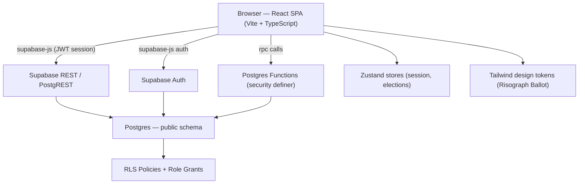
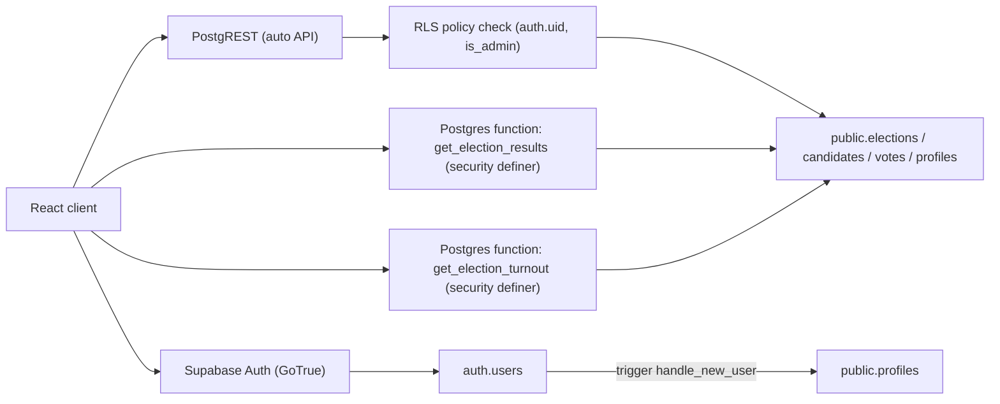
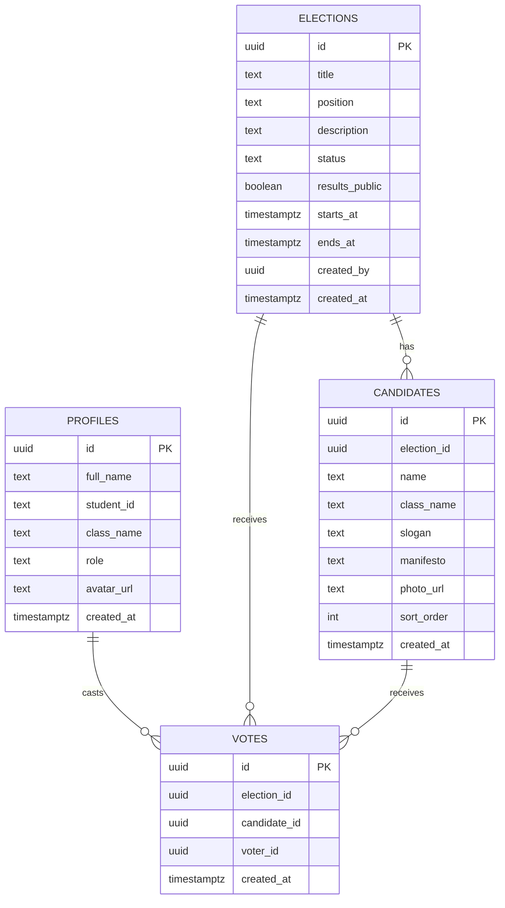

# Technical Architecture — BallotBox: SHS Student Council & Prefect Elections

## 1. Architecture Design



Layers: **Frontend** (React SPA) → **Supabase platform** (Auth, PostgREST, Postgres functions) → **Data** (Postgres tables + RLS). There is no separate custom backend service: Supabase provides the API, authentication, authorization and database. All privileged reads/writes are gated by Row Level Security and `SECURITY DEFINER` functions rather than a trusted client.

## 2. Technology Description

- **Frontend**: React@18 + TypeScript + Vite 5 + TailwindCSS 3
- **Initialization Tool**: `vite-init` (template `react-ts`)
- **Routing**: `react-router-dom` v6
- **State management**: `zustand`
- **Icons**: `lucide-react`
- **Backend / Database / Auth**: Supabase (Postgres 15, PostgREST, Supabase Auth) via `@supabase/supabase-js`
- **Backend config**: `src/lib/supabase.ts` uses the project URL + anon key (RLS enforced). The service-role key is never shipped to the browser.
- **Migrations**: `supabase/migrations/*.sql`
- **Testing**: Vitest (unit/component) + SQL verification queries for data integrity

## 3. Route Definitions

| Route | Purpose |
|-------|---------|
| `/` | Landing page with hero, how-it-works and featured live election |
| `/login` | Log in |
| `/signup` | Student sign up |
| `/elections` | Elections hub (student) with status filters and search |
| `/elections/:id` | Election detail: candidate profiles + ballot |
| `/elections/:id/results` | Published results for an election |
| `/profile` | Student profile and voting history |
| `/admin` | Admin dashboard: stats and election table |
| `/admin/elections/new` | Create a new election |
| `/admin/elections/:id` | Edit election metadata and manage candidates |
| `/admin/elections/:id/results` | Admin turnout and live tally monitor |
| `*` | Not-found page |

Route guards: `/admin/*` requires `profile.role === 'admin'`; `/profile` requires an authenticated session; voting actions require authentication.

## 4. API Definitions

All data access goes through `supabase-js`. Table access is RLS-protected; sensitive aggregation goes through an RPC.

```typescript
// shared/types.ts
export type Role = 'student' | 'admin';
export type ElectionStatus = 'draft' | 'active' | 'closed';

export interface Profile {
  id: string;
  full_name: string;
  student_id: string | null;
  class_name: string | null;
  role: Role;
  avatar_url: string | null;
  created_at: string;
}

export interface Election {
  id: string;
  title: string;
  position: string;
  description: string | null;
  status: ElectionStatus;
  results_public: boolean;
  starts_at: string | null;
  ends_at: string | null;
  created_by: string | null;
  created_at: string;
}

export interface Candidate {
  id: string;
  election_id: string;
  name: string;
  class_name: string | null;
  slogan: string | null;
  manifesto: string | null;
  photo_url: string | null;
  sort_order: number;
  created_at: string;
}

export interface ElectionResultRow {
  candidate_id: string;
  candidate_name: string;
  class_name: string | null;
  photo_url: string | null;
  vote_count: number;
}

export interface Turnout {
  voted: number;
  eligible: number;
}
```

**Table operations (RLS-gated)**

| Operation | Call | Who |
|-----------|------|-----|
| List elections | `supabase.from('elections').select('*').order('created_at', { ascending: false })` | any authenticated user |
| List candidates | `supabase.from('candidates').select('*').eq('election_id', id).order('sort_order')` | any authenticated user |
| Cast vote | `supabase.from('votes').insert({ election_id, candidate_id, voter_id })` | authenticated student, once per election |
| Has voted | `supabase.from('votes').select('election_id')` | own votes (RLS) |
| Create/update election | `supabase.from('elections').insert/update(...)` | admin only (RLS) |
| Manage candidates | `supabase.from('candidates').insert/update/delete(...)` | admin only (RLS) |
| Update own profile | `supabase.from('profiles').update(...).eq('id', uid)` | self |

**RPC**

```typescript
// Published results (works for students when results_public = true; always for admins)
const { data } = await supabase.rpc('get_election_results', { p_election_id: electionId });

// Turnout (admin only)
const { data } = await supabase.rpc('get_election_turnout', { p_election_id: electionId });
```

## 5. Server Architecture Diagram



## 6. Data Model

### 6.1 Data Model Definition

Logical (application-level) foreign keys are used: `elections.created_by`, `candidates.election_id`, `votes.election_id`, `votes.candidate_id`, `votes.voter_id`.



### 6.2 Data Definition Language

Implemented in `supabase/migrations/001_init_voting.sql` (schema, RLS, grants, functions, triggers, seed data) and `supabase/migrations/002_seed_admin.sql` (seed Electoral Officer account).

```sql
-- 001_init_voting.sql (key excerpts)

-- PROFILES
create table public.profiles (
  id uuid primary key,
  full_name text not null,
  student_id text unique,
  class_name text,
  role text not null default 'student' check (role in ('student','admin')),
  avatar_url text,
  created_at timestamptz not null default now()
);

-- ELECTIONS
create table public.elections (
  id uuid primary key default gen_random_uuid(),
  title text not null,
  position text not null,
  description text,
  status text not null default 'draft' check (status in ('draft','active','closed')),
  results_public boolean not null default false,
  starts_at timestamptz,
  ends_at timestamptz,
  created_by uuid,
  created_at timestamptz not null default now()
);

-- CANDIDATES
create table public.candidates (
  id uuid primary key default gen_random_uuid(),
  election_id uuid not null,
  name text not null,
  class_name text,
  slogan text,
  manifesto text,
  photo_url text,
  sort_order integer not null default 0,
  created_at timestamptz not null default now()
);

-- VOTES  (one vote per voter per election, enforced by a unique constraint)
create table public.votes (
  id uuid primary key default gen_random_uuid(),
  election_id uuid not null,
  candidate_id uuid not null,
  voter_id uuid not null,
  created_at timestamptz not null default now(),
  unique (election_id, voter_id)
);

create index candidates_election_idx on public.candidates (election_id, sort_order);
create index votes_election_idx on public.votes (election_id);
create index votes_voter_idx on public.votes (voter_id);
```

RLS summary:

- `profiles`: any authenticated user may `select`; a user may `insert`/`update` only their own row; admins may update/delete any row.
- `elections`: `select` for all authenticated users; `insert`/`update`/`delete` only when `public.is_admin()`.
- `candidates`: `select` for all authenticated users; `insert`/`update`/`delete` only when `public.is_admin()`.
- `votes`: a student may `select` only their own votes; admins may `select` all. `insert` requires `voter_id = auth.uid()` and the target election to be `active`. No `update`/`delete` policy — votes are immutable.

Helper functions: `public.is_admin()` and `public.handle_new_user()` (trigger that creates a `profiles` row on sign-up). Result aggregation is exposed only through `public.get_election_results(uuid)`, which raises an exception when `results_public` is false and the caller is not an admin — this keeps individual ballots secret.

Explicit grants are applied to the `anon` and `authenticated` roles so RLS is the only remaining gate:

```sql
grant usage on schema public to anon, authenticated;
grant select on public.elections, public.candidates to anon, authenticated;
grant select, insert, update on public.profiles to authenticated;
grant all privileges on public.elections, public.candidates to authenticated;
grant select, insert on public.votes to authenticated;
grant execute on function public.get_election_results(uuid) to anon, authenticated;
grant execute on function public.get_election_turnout(uuid) to authenticated;
```
